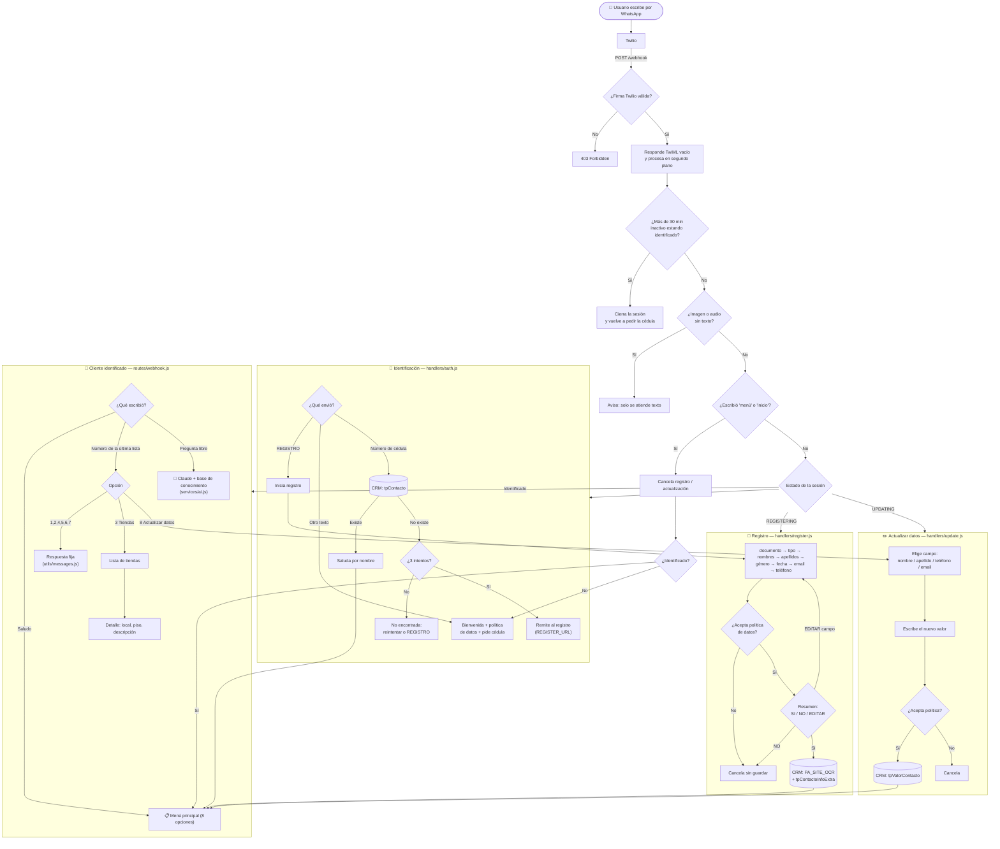
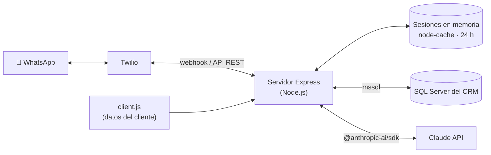

# Chatbot CC

Asistente de WhatsApp para **centros comerciales**.
Identifica al cliente con su cédula contra el CRM, permite registrarse y actualizar sus datos
(con autorización de tratamiento de datos personales) y responde preguntas sobre el centro comercial
con un menú de opciones y con IA (Claude) limitada a una base de conocimiento propia.

## Funcionalidades

| Función | Descripción |
|---------|-------------|
| **Identificación** | Pide la cédula y la valida en el CRM (SQL Server). Tras 3 intentos fallidos remite al registro. La identificación vence tras 30 min de inactividad. |
| **Registro** | Flujo guiado de 9 pasos con validación de cada dato, autorización de datos obligatoria y resumen final para confirmar o editar. |
| **Actualizar mis datos** | Cambio de nombre, apellido, teléfono o email; cada cambio exige aceptar la política antes de guardarse. |
| **Menú informativo** | Horarios, ubicación, tiendas y marcas, eventos y sorteos, parqueadero y servicios, PQRS y redes sociales. |
| **Preguntas libres** | Claude responde *solo* con la información de `src/data/client.js`; si el dato no existe, lo dice. |

## Flujo de funcionamiento

Cada mensaje que llega por WhatsApp recorre este camino:



El detalle de los estados, reglas del flujo y cómo actualizar la información está en
[`docs/FLOW_DESIGN.md`](docs/FLOW_DESIGN.md).

## Arquitectura



- **Twilio WhatsApp**: recepción (webhook) y envío de mensajes. Los menús se envían como listas numeradas.
- **SQL Server (CRM)**: misma base del bot general — `tpContacto`, `tpValorContacto`,
  `tpContactoInfoExtra` y el procedimiento `dbo.PA_SITE_OCR`.
- **Claude**: responde preguntas libres usando solo la base de conocimiento (prompt cacheado).
- **Sesiones**: en memoria con `node-cache`; se pierden al reiniciar el servidor.

## Requisitos

- Node.js 18 o superior
- Cuenta de Twilio con WhatsApp (sandbox o número aprobado)
- API key de Anthropic
- Acceso al SQL Server del CRM

## Instalación

```bash
npm install
cp .env.example .env                              # y completa las variables
cp src/data/client.example.js src/data/client.js  # y completa los datos del cliente
npm run dev                                       # desarrollo (nodemon)
npm start                                         # producción
```

### Variables de entorno

| Variable | Obligatoria | Descripción |
|----------|:-----------:|-------------|
| `TWILIO_ACCOUNT_SID` | ✅ | SID de la cuenta Twilio |
| `TWILIO_AUTH_TOKEN` | ✅ | Token de Twilio. Si está vacío no se valida la firma del webhook (solo desarrollo) |
| `TWILIO_WHATSAPP_NUMBER` | ✅ | Número emisor, p. ej. `whatsapp:+14155238886` |
| `ANTHROPIC_API_KEY` | ✅ | API key de Claude |
| `ANTHROPIC_MODEL` | | Modelo a usar (por defecto `claude-opus-5-5`) |
| `DB_SERVER`, `DB_NAME`, `DB_USER`, `DB_PASSWORD` | ✅ | Conexión al SQL Server del CRM |
| `POLICY_URL` | ✅ | Enlace a la política de tratamiento de datos personales |
| `REGISTER_URL` | | Registro web al que se remite tras 3 cédulas no encontradas |
| `AUTH_TIMEOUT_MINUTES` | | Inactividad antes de volver a pedir la cédula (por defecto 30) |
| `PORT` | | Puerto del servidor (por defecto 3000) |
| `BASE_URL` | ✅ | URL pública del servidor; se usa para validar la firma de Twilio |

### Conectar con Twilio

1. Expón el servidor (p. ej. `ngrok http 3000`) y pon esa URL en `BASE_URL`.
2. En la consola de Twilio → *Messaging → WhatsApp sandbox settings*, configura
   **When a message comes in** = `https://<BASE_URL>/webhook` (método `POST`).
3. Opcional: **Status callback URL** = `https://<BASE_URL>/status_callback`.

### Endpoints

| Método | Ruta | Uso |
|--------|------|-----|
| `POST` | `/webhook` | Mensajes entrantes de Twilio |
| `GET` | `/webhook` | Comprobación manual |
| `GET` | `/health` | Health check |
| `POST` | `/status_callback` | Estados de entrega de Twilio (solo acusa recibo) |

## Estructura

```
src/
├── index.js                 # Servidor Express
├── routes/webhook.js        # Enrutador de mensajes
├── flows/stateMachine.js    # Estados de la conversación
├── handlers/
│   ├── auth.js              # Identificación con cédula
│   ├── register.js          # Registro + autorización de datos
│   ├── update.js            # Actualización de datos + autorización
│   └── info.js              # Menú, tiendas y preguntas libres
├── data/
│   ├── knowledgeBase.js     # Carga los datos del cliente + helpers para menús y prompt
│   ├── client.example.js    # Plantilla de datos (versionada)
│   └── client.js            # Datos reales del cliente (privado, en .gitignore)
├── services/
│   ├── ai.js                # Claude
│   ├── db.js                # SQL Server del CRM
│   ├── session.js           # Sesiones en memoria + historial
│   └── whatsapp.js          # Cliente Twilio
└── utils/
    ├── messages.js          # Plantillas de texto
    └── validators.js        # Validación de datos del cliente
docs/
└── FLOW_DESIGN.md           # Diseño detallado del flujo y estados
```

## Datos del cliente

La información del cliente (nombre, tiendas, horarios, eventos, redes, contacto) **no se versiona**:
vive en `src/data/client.js`, que está en `.gitignore` junto con los documentos del cliente (`*.docx`,
`docs/funciones-bot.html`).

1. Copia la plantilla: `cp src/data/client.example.js src/data/client.js`
2. Reemplaza los valores con los datos reales.

Si `client.js` no existe, el bot arranca con los datos de ejemplo y lo avisa en consola.
Los menús y el prompt de la IA se generan a partir de ese archivo, así que no hay que tocar nada más.
Para un sorteo con fechas, agrega `startDate` / `endDate` (`YYYY-MM-DD`) y el bot calculará si está vigente.
