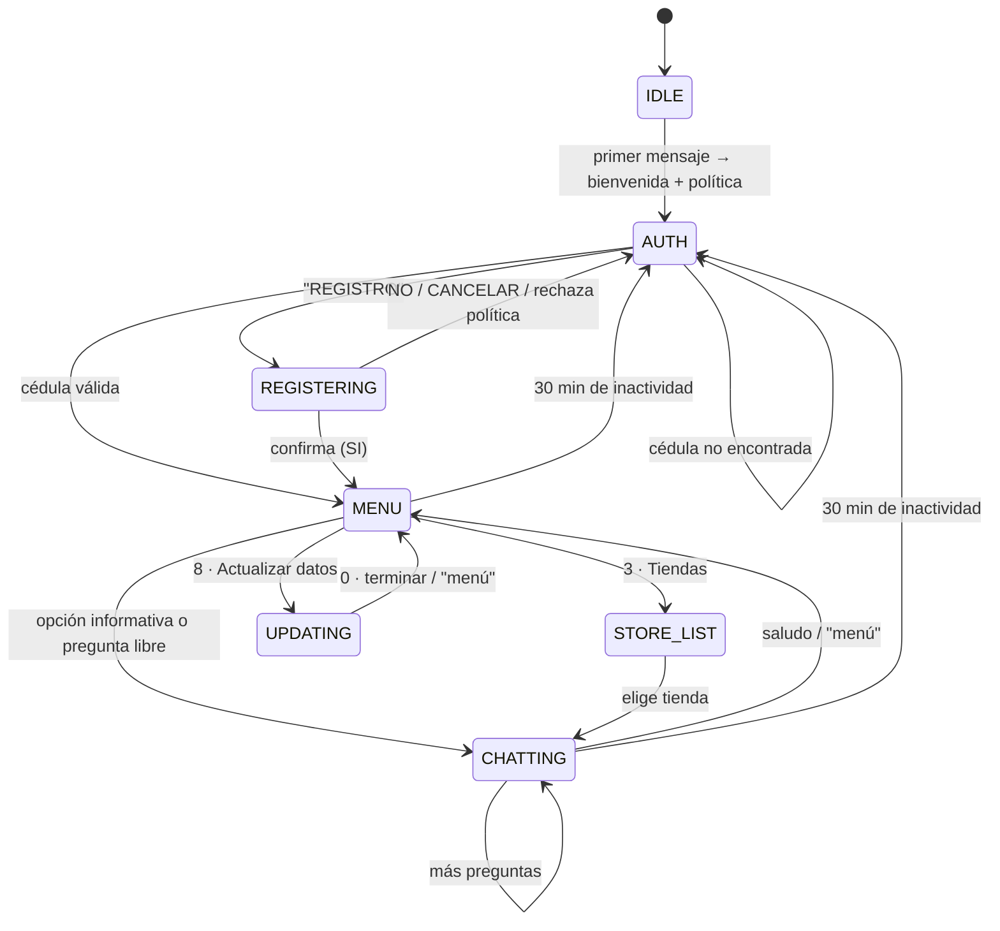

# Chatbot CC – Diseño del flujo

Asistente de WhatsApp (Twilio) que da información de un centro comercial. Toda la información
del cliente sale de `src/data/client.js` (privado, ignorado por git; plantilla en `client.example.js`).

## Arquitectura

```
Usuario (WhatsApp) → Twilio → POST /webhook → routes/webhook.js
                                                 │
                       ┌─────────────────────────┼──────────────────────────┐
                       ▼                         ▼                          ▼
              Saludo / "menú"           Número de opción             Pregunta libre
              → menú principal          → respuesta fija              → Claude + base de
                                          (utils/messages.js)           conocimiento (services/ai.js)
```

## Flujo

1. **Identificación (obligatoria)**: el primer mensaje recibe la bienvenida con el enlace a la
   *Política de tratamiento de datos personales* y se pide la cédula. Se valida contra la BD del CRM
   (`tpContacto.conNdoc`). Si existe, se saluda por nombre y se muestra el menú; si no, se ofrece
   **REGISTRO**. Tras 3 cédulas no encontradas se remite al registro (y a `REGISTER_URL` si está configurado).
   Tras `AUTH_TIMEOUT_MINUTES` de inactividad (30 por defecto) se vuelve a pedir la cédula.
2. **Registro** ("REGISTRO"): documento → tipo → nombres → apellidos → género → fecha → email →
   teléfono → **autorización de datos personales** (obligatoria; si no acepta, se cancela sin guardar)
   → resumen para confirmar (SI / NO / EDITAR campo). Se guarda con `dbo.PA_SITE_OCR` y se registra la
   autorización en `tpContactoInfoExtra` (`infoPolDat`, `infoCel`, `infoFact`).
3. **Menú principal**
   1. Horarios
   2. Ubicación (con enlace a Google Maps)
   3. Tiendas y marcas → submenú con las tiendas configuradas → detalle (local, piso, descripción)
   4. Eventos y sorteos (los eventos con fechas muestran si están vigentes o finalizados)
   5. Parqueadero y servicios
   6. Atención al cliente / PQRS
   7. Redes sociales
   8. Actualizar mis datos → nombre / apellido / teléfono / email; cada cambio pide aceptar la
      política antes de guardarse en `tpValorContacto`.
4. **Preguntas libres** ("¿dónde queda Adidas?", "¿hay cajero?") → Claude responde **solo** con la base
   de conocimiento. Si el dato no existe, lo dice y remite al directorio o a Atención al Cliente.
5. "menú" / "inicio" en cualquier momento cancela el registro/actualización en curso y vuelve al menú
   (o a la bienvenida si el usuario aún no se ha identificado).
6. Imágenes o audios sin texto → aviso de que solo se atiende texto.

> El diagrama completo del recorrido de un mensaje está en el [README](../README.md#flujo-de-funcionamiento).

## Estados (`flows/stateMachine.js`)



| Estado       | Significado                                  |
|--------------|----------------------------------------------|
| `IDLE`       | Sin conversación → el próximo mensaje saluda |
| `AUTH`       | Esperando cédula o REGISTRO                  |
| `REGISTERING`| Registro de cliente en curso                 |
| `UPDATING`   | Actualización de datos en curso              |
| `MENU`       | Se mostró el menú principal                  |
| `STORE_LIST` | Se mostró la lista de tiendas                |
| `CHATTING`   | Conversación en curso                        |

Los números se resuelven contra la **última lista mostrada** (`session.pendingButtonMap`).
Solo un mensaje que es únicamente un número cuenta como opción.

## Actualizar la información

Edita `src/data/client.js`: los menús y el prompt de la IA se generan a partir de ahí.
Para un nuevo sorteo con fechas, agrega `startDate` / `endDate` (YYYY-MM-DD) y el bot calculará
si está vigente.

## Archivos

```
src/
├── index.js                 # Servidor Express
├── routes/webhook.js        # Enrutador de mensajes (saludo, menú, opciones, preguntas)
├── handlers/
│   ├── info.js              # Respuestas del menú, tiendas y preguntas libres
│   ├── auth.js              # Identificación con cédula
│   ├── register.js          # Registro + autorización de datos personales
│   └── update.js            # Actualización de datos + autorización
├── data/
│   ├── knowledgeBase.js     # Carga los datos del cliente + helpers
│   ├── client.example.js    # Plantilla de datos
│   └── client.js            # Datos reales (privado, en .gitignore)
├── services/
│   ├── ai.js                # Claude (respuestas basadas en la base de conocimiento)
│   ├── db.js                # SQL Server del CRM (consulta, registro, actualización, política)
│   ├── session.js           # Sesiones en memoria (24 h) + historial
│   └── whatsapp.js          # Cliente Twilio WhatsApp
├── flows/stateMachine.js    # Estados
└── utils/
    ├── messages.js          # Plantillas de texto
    └── validators.js        # Validación de los datos del cliente
```
